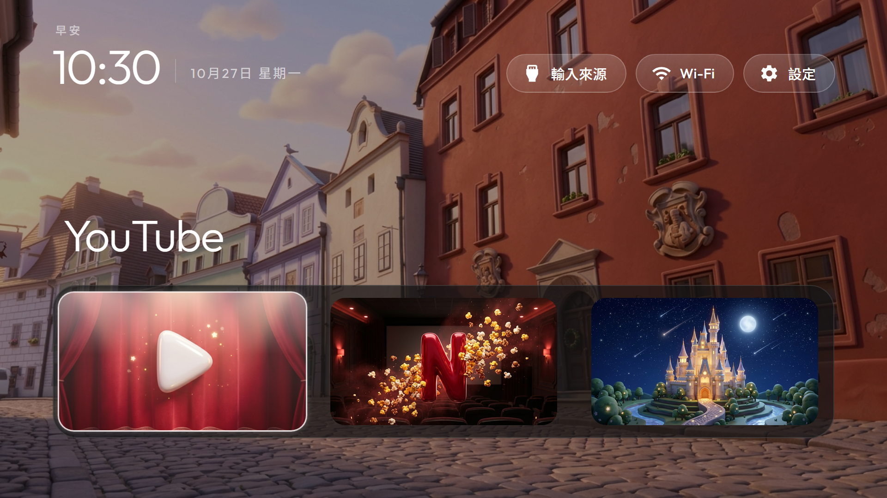
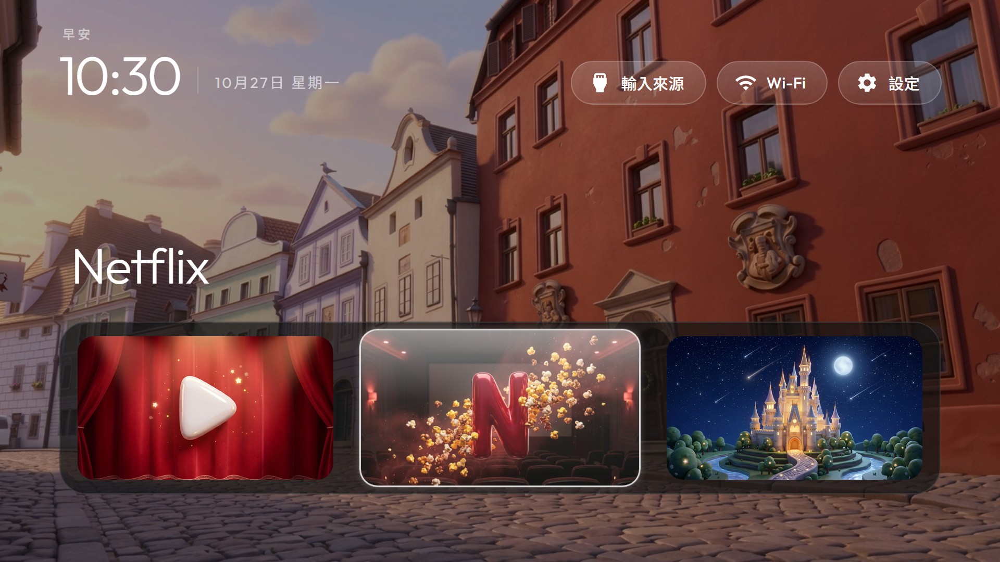
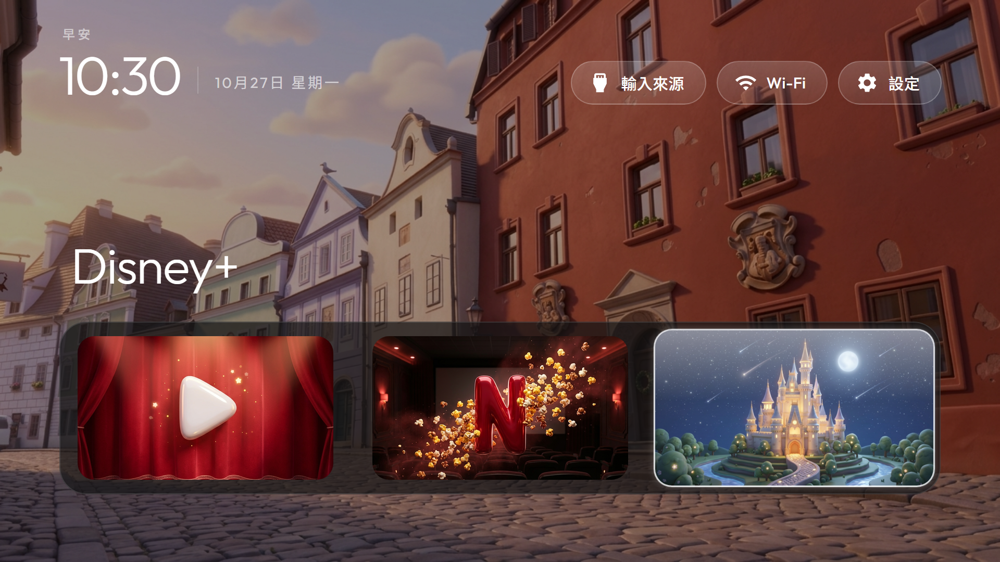

# 7. 皮克斯風主題（選配）

> 這一章是額外的玩法，**不影響**前面的去廣告與換首頁。其中「寬按鈕」需要修改 launcher 程式，**目前只做到模擬圖與 patch，尚未在電視上實際驗證**。

## 預覽（模擬圖，不是實機截圖）

| 游標在 YouTube | 游標在 Netflix | 游標在 Disney+ |
|---|---|---|
|  |  |  |

背景是用 Gemini 轉成皮克斯風的旅遊照片（無人物的街景），三顆按鈕是滿版的皮克斯風橫幅，並套用寬按鈕版面。

## A. 把照片轉成皮克斯風桌布

任何能「上傳照片＋文字指示＋出圖」的圖像生成工具都可以，以下以 Gemini 網頁版（gemini.google.com）為例：在瀏覽器打開它，**一張一張上傳照片**，貼上提示詞送出，出圖後下載。實測：

- 一張約 30～45 秒；免費帳號每天的張數有限，用完就隔天再做。
- 輸出 1376×768（約 16:9），下載用圖片右上角的「下載原尺寸」。
- **提示詞的數字與冒號要寫成中文**（「十六比九」而不是 16:9），網頁輸入框有時會吞掉半形數字與冒號。
- 第一張常常只回文字，補一句「請用圖片生成功能直接畫」就會出圖。

實際用的提示詞：

```
請用圖片生成功能，把這張照片重新繪製成皮克斯動畫電影風格的三維卡通插畫，要明顯卡通化、不要寫實：人物變成可愛的皮克斯角色並保留髮型、眼鏡、服裝與表情；建築、風景與物品變得圓潤可愛；保留原本構圖與色彩，柔和的電影級打光。輸出橫式寬螢幕畫面，比例十六比九，不要加任何文字。
```

「要明顯卡通化、不要寫實」很重要：沒有這句時，風景照（例如黃昏小鎮）常常幾乎不變。

**隱私提醒**：上傳的照片（含人臉）會送到 Google 的服務。建議先用 [`scripts/make_wallpapers.py`](../scripts/make_wallpapers.py) 處理過的版本上傳（已去除 GPS 等拍攝資訊），並用自己的帳號、確認家人同意。

轉好的圖一樣丟進 `wallpapers/` 資料夾、用 `make_wallpapers.py` 統一尺寸後推上電視（第 5 章）。

## B. 三顆按鈕換成皮克斯風圖

### 要做成「滿版」

第一次生成的是「方形圓角圖示」，放進 16:9 的按鈕後**多了一圈內框**，看起來像兩層邊界。最後改成直接生成**整張滿版的 16:9 橫幅**（例：紅色舞台布幕前的白色播放鍵、電影院裡飛出爆米花的紅色 N、星空下發光的城堡），提示詞要寫「整張畫面滿版、沒有任何外框或圓角方塊、沒有黑邊」。若四周仍有黑邊要先裁掉再裁成 16:9。

### 怎麼放進首頁（需要重新編譯）

`config.json` 的 `app_banners` **只能指向 launcher 內建的圖**，不能直接讀電視上的檔案：

1. 圖片轉成 WebP（三張約 20～60 KB），檔名以 `banner_` 開頭，例如 `banner_pixar_youtube.webp`。
2. 放進 `launcher/app/src/main/res/drawable-nodpi/`（`banner_*` 已在 `res/raw/keep.xml` 保護，不會被編譯時刪掉）。
3. `config.json` 加：

```json
"app_banners": [
  "com.google.android.youtube.tv=banner_pixar_youtube",
  "com.netflix.ninja=banner_pixar_netflix",
  "com.disney.disneyplus=banner_pixar_disney"
]
```

4. 重跑 `launcher\build-and-install.ps1`。

尺寸：預設按鈕在 1080p 約 360×202 px；寬按鈕版約 491×276 px。

### 商標注意

這些圖是在模仿 YouTube、Netflix、Disney+ 的標誌，**自己家裡用沒問題，但不要散布生成的圖檔**。所以本 repo 不附按鈕圖、也不附任何轉換後的私人照片，請自己生成。

## C. 寬按鈕版面（需要改程式，未驗證）

原版 launcher 把每顆按鈕寬度上限鎖在 180dp（1080p 約 360 px），所以只放 3 個 App、把欄數設成 3 時，按鈕不會變大，只是間距變寬。

[`patches/dock_fill_width.diff`](../patches/dock_fill_width.diff) 新增一個**預設關閉**的 `dock_fill_width` 設定，開啟後按鈕可放大到填滿格寬（3 欄時約 491×276 px，大 36%），關閉時行為完全不變。

> ⚠️ **這份 patch 只確認過能乾淨套用到原專案 commit `34e1c42`（`git apply --check`），沒有編譯、沒有跑測試、也沒有上電視驗證。** 使用前請自行在 `launcher/` 執行 `.\gradlew.bat testReleaseUnitTest lintRelease assembleRelease`，並在電視上用遙控器把每個方向都按過一遍。

已知風險：

- 選到最左或最右的按鈕時，放大 1.1 倍後離畫面邊緣只剩約 12 px，若實機邊距跟推算不同可能被切到。
- 開啟後 dock 下方其他 App 的按鈕也會一起變大，它們自帶的 320×180 圖會被放大而變模糊。
- 按鈕不會「完全」貼滿，因為原設計留了放大 1.1 倍的空間。

套用方式：

```powershell
cd <cleanyourtv 路徑>
git apply <本 repo 路徑>\patches\dock_fill_width.diff
```

然後在 `config.json` 加 `"dock_fill_width": true, "columns": 3, "rows_below_dock": 0`，dock 只放三個 App。

依原專案的貢獻規則，這類版面修改屬於個人 fork 的範圍，不會被合併回原專案。
